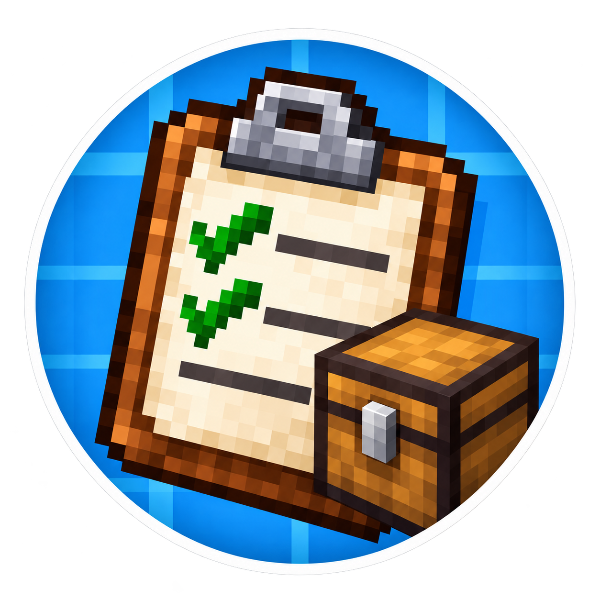

# Create: Clipboard Toolkit

Minecraft 1.21.1 / NeoForge 向けの、Create のクリップボードを拡張する Mod です。
収納の中身や、指定した範囲のブロックを、アイコン・個数付きのリストとして記録できます。

## 主な機能

- **収納の記録**：チェストや樽、Item Vault などの中身をまとめてリスト化。
- **範囲の記録**：2点で指定した範囲の設置ブロックと収納アイテムを集計。
- **設置・収納を別々に管理**：設置済みの資材と保管中の資材を混ぜず、別ページに表示。
- **Create 標準の表示**：記録したリストをクリップボードで閲覧し、チェックを付けられます。
- **チェック済み素材の注文除外**：倉庫への注文に取り込む際、チェック済みの項目を除外します。
- **クリップボードのロック**：貼り付け・編集・スキャンによる変更を防ぎ、コピー元としての利用とチェック操作は続けられます。
- **アイテムリストのコピー**：設置したボードからコピーするときもアイコン・個数・チェック状態を保持し、コピー先のリストで倉庫に注文できます。

サバイバルでコマンドや OP 権限を使わずに利用できます。

## 必要な環境

| 対象 | バージョン |
| --- | --- |
| Minecraft | 1.21.1 |
| NeoForge | 21.1.234 以上 |
| Create | 6.0.10 以上、6.1.0 未満 |

**Create が必須です。** マルチプレイでは、サーバーとクライアントの両方にこの Mod を導入してください。
シングルプレイでは、自分の環境に導入するだけで利用できます。

JEI / EMI との連携は当面見送っています。どちらも導入は不要です。

## 使い方

### 収納の中身を記録する

1. **空の Create クリップボード**をメインハンドに持ちます。
2. 収納ブロックに向かって **左 Alt + 右クリック**します。
3. Alt を離し、空中を右クリックして記録したリストを開きます。

同じアイテムは数量を合算します。名前・耐久値・エンチャントなどが異なるアイテムは別項目になります。
収納内のアイテムを取り出したり、消費したりすることはありません。

### 範囲をまとめて記録する

1. 空のクリップボードをメインハンドに持ち、**G** で範囲選択を開始します。
2. **右クリックで始点、もう一度右クリックで終点**を指定します。各点で一度ボタンを離してください。
3. 表示された枠を確認し、**G で記録**します。右クリックで終点を変更できます。
4. クリップボードを開くと、**「設置ブロック」「収納アイテム」**が別ページに表示されます。

選択を中止するには **Shift + G** を押します。持ち替え・ディメンション変更・切断でも選択が解除されます。
キーは「操作設定 → Create: Clipboard Toolkit」から変更できます。

たとえば、設置済みの鉄ブロック10個とチェスト内の鉄ブロック20個は、それぞれ別のリストとして保存されます。
ドア・ベッドなどの2マス構造は重複を除き、重ねたハーフブロックは2個として数えます。

### チェック済みの素材を注文から除外する

クリップボードで不要な素材にチェックを付け、そのクリップボードをメインハンドに持って Create の倉庫の注文画面を開きます。アイコン付きリストのうち、チェックが付いていない項目だけが注文に取り込まれます。注文数量は倉庫の在庫数を上限とします。
記録した個数は変わりません。チェックを外して注文画面を開き直すと、再び注文対象になります。通常の Create クリップボードにも適用されます。

範囲記録では「設置ブロック」「収納アイテム」の両方が対象です。注文に含めたくない項目にはチェックを付けてください。

### クリップボードをロックする（1.0.1～）

クリップボードを開き、右側の **鍵ボタン** を押すとロック／解除を切り替えられます。手持ち・設置したクリップボードの両方に対応します。

- **ロック中に防ぐ操作**：そのボードへのコピーの取り込み、貼り付け・本文編集、チェック済み項目の一括削除、収納・範囲スキャン。
- **ロック中も使える操作**：閲覧、ページ移動、チェックの付け外し、他のボードへのコピー元としての利用、保存済みの機械設定の貼り付け。
- ロック状態は保存され、設置・回収しても維持されます。解除後は通常の操作に戻ります。スキャンで記録したリストの本文は、解除後も従来どおり読み取り専用です。

Create のボード間コピーは、設置したボードから手持ちのボードへ内容を取り込みます。コピー先として使う手持ちのボードは、ロックを解除してください。
ロックは誤操作を防ぐための機能です。所有者だけに解除を制限するものではありません。

### アイテムリストをコピーする（1.0.2～）

リストのあるクリップボードを設置し、コピー先のクリップボードを持って右クリックします。アイコン・個数・チェック状態を保持してコピーするため、コピー先も倉庫への注文に使えます。チェック済み項目は注文から除外されます。

コピー元はロックしたままで利用できます。コピー先のロックは解除してください。
Create 標準の追記・重複除外に従うため、確実にリストを複製するには空のボードを使ってください。以前のコピーで失われたアイコンや個数は自動復元されないので、元のリストから空のボードへコピーし直してください。

## 対応する収納

- チェスト・トラップチェスト・ラージチェスト
- 樽・シュルカーボックス・ホッパー・かまど・ドロッパーなど
- Create の Item Vault
- NeoForge の共通アイテム収納APIに対応した、他 Mod の収納

ラージチェストと Item Vault は、結合した収納全体を一度だけ集計します。
機械類では、公開されている材料・燃料・完成品などのスロットが対象です。収納によっては、読み取れる内容がクリックした面に依存します。範囲記録では、その場合は上面を使用します。

エンダーチェストは、単体の記録では操作した本人の中身を読み取ります。範囲記録では個人在庫を除外し、設置ブロックだけを数えます。
他 Mod 独自の収納方式・ネットワーク・権限管理には、個別対応が必要な場合があります。

## 記録のルールと制限

- **記入済みのクリップボードは上書きしません。** 再記録には別の空のクリップボードを使ってください。読み取り専用・設定コピー済みのものも対象外です。
- 記録後はチェック欄を使用できますが、本文は読み取り専用です。
- 鍵付き・アクセス禁止・蓋が開かない収納は記録できません。
- 未開封の戦利品収納は、単体記録では通常の開封と同じ条件で中身を生成します。範囲記録では先に開封が必要です。
- 範囲内に未読み込みの場所や素材に変換できないブロックがある場合、保存せず通知します。
- ラージチェストや Item Vault が範囲外にはみ出す場合は、全体が収まるよう範囲を広げてください。
- 流体・エネルギー・エンティティの収納、オフハンドからの記録は対象外です。

| 項目 | 上限 |
| --- | --- |
| 選択範囲 | 4,096ブロック、各辺64ブロック |
| 範囲確定時の距離 | 両端からそれぞれ64ブロック以内 |
| 単体記録 | 350種類・50ページ |
| 範囲記録 | 設置・収納合わせて50ページ（見出し＋6項目／ページ） |
| 読み取る収納スロット | 1回の記録につき16,384スロット |
| 1種類あたりの数量 | 2,147,483,647個 |

上限を超えた場合、途中までの結果は保存せず、クリップボードを変更しません。範囲選択の赤い枠はサイズ上限超過を示します。

## 関連プロジェクト

- [Create](https://github.com/Creators-of-Create/Create)
- [NeoForge](https://neoforged.net/)
